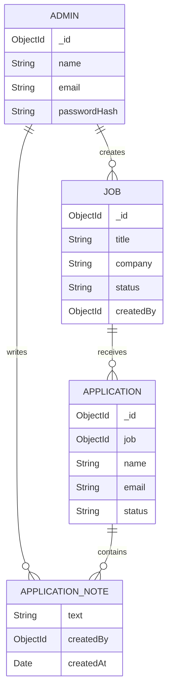

# CareerTrack Database Schema

Database name (default): `careertrack`

## Collections

### admins
- `_id`: ObjectId
- `name`: String, required
- `email`: String, required, unique, lowercase
- `passwordHash`: String, required (bcrypt hash only)
- `role`: `admin`
- `createdAt`, `updatedAt`

### jobs
- `_id`: ObjectId
- `title`, `company`, `location`: required strings
- `employmentType`: Full-time / Part-time / Contract / Internship / Remote
- `experienceLevel`: Entry level / Mid level / Senior level / Any experience
- `salaryRange`, `description`
- `responsibilities[]`, `qualifications[]`, `skills[]`, `benefits[]`
- `applicationDeadline`: Date or null
- `status`: draft / published / unpublished / closed
- `createdBy`: ObjectId reference to admins
- `createdAt`, `updatedAt`

Indexes: `{status:1, createdAt:-1}` and text index on title, company, location.

### applications
- `_id`: ObjectId
- `job`: ObjectId reference to jobs
- `name`, `email`, `phone`, `education`, `experience`, `skills`, `coverLetter`
- `resume`: originalName, storedName, mimeType, size
- `status`: Submitted / Under Review / Shortlisted / Interview Scheduled / Selected / Rejected
- `internalNotes[]`: text, createdBy (Admin reference), createdAt
- `createdAt`, `updatedAt`

Indexes: unique compound `{job:1,email:1}` prevents repeat applications for a job; `{status:1,createdAt:-1}` supports status/date filtering.

## Relationship

One administrator can create many jobs. One job can receive many applications. Each application belongs to exactly one job. Internal notes are embedded in the application and reference the administrator who added them.

Candidate contact details and résumé metadata are private. Never use real candidate records in sample data or public repositories.
